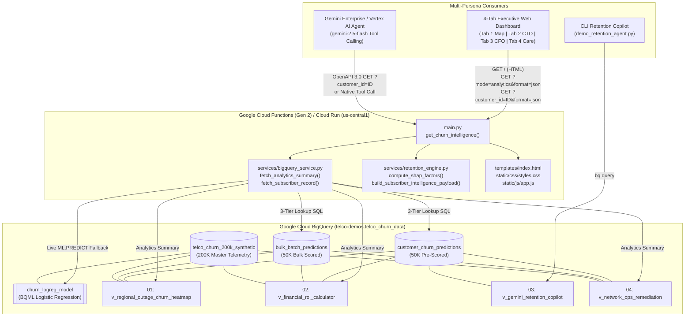
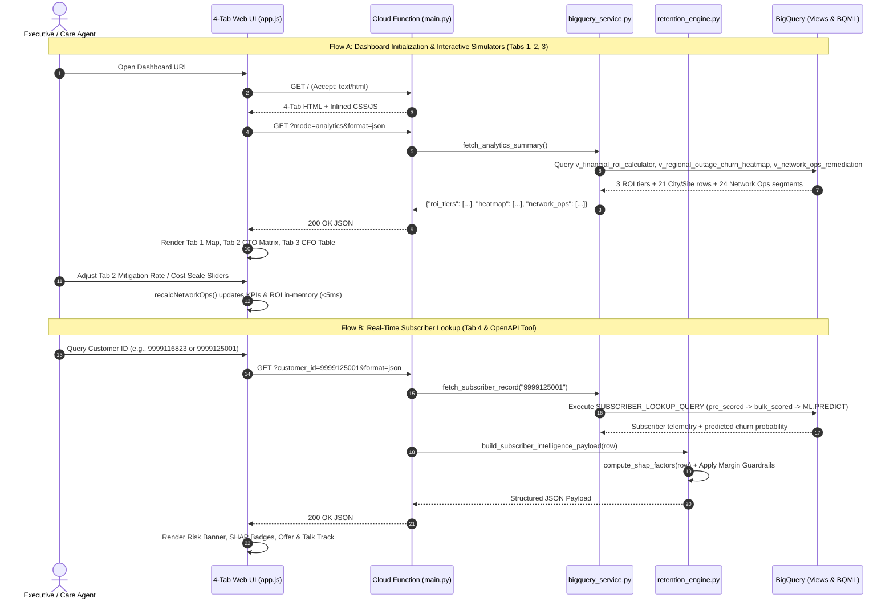

# Telco Churn Intelligence, Network Remediation & Retention Platform — Software Design Document (SDD)

- **Author(s):** Telco Data & AI Engineering Team
- **Date:** 2026-10-06
- **Status:** Approved / Implemented
- **Reviewers:** Circle Operations GM, CTO / Network Engineering Lead, Commercial CFO, Customer Care Director
- **Last Updated:** 2026-10-06
- **Related Documents:** `docs/requirements_document.md` (BRD/PRD), `docs/test_document.md` (QA Test Plan & Results)

---

## 1. Problem Statement

### What problem are we solving?
Telecom broadband (FTTH / 5G AirFiber) operators lose millions in Annual Recurring Revenue (ARR) because **Customer Care** and **Network Engineering** act in isolated silos:
1. **Commercial Care teams** issue reactive bill credits and discounts to complaining subscribers without fixing the underlying physical fault (e.g., failing ONT routers, degraded aerial fiber, or high-loss Local Cable Operator splices)—and frequently waste budget subsidizing `LOW_RISK` subscribers.
2. **Network Operations (NOC) & Field Engineering teams** monitor network alarms and tickets (`CUSTSRS`, `CUSTREPEATS`) without visibility into **subscriber churn probability** or **Annual Revenue at Risk (`ARR`)** per CPE hardware model or last-mile plant segment.

### Who is affected?
1. **Circle Operations Heads / Regional GMs** (lack city-by-city and cabinet-level churn/outage visibility).
2. **CTO & Network Engineering Teams** (cannot prioritize CapEx/OpEx between ONT swaps, OTA firmware patches, fiber overbuilds, and LCO audits based on revenue impact).
3. **Commercial CFO & CVM Directors** (suffer margin erosion from unguarded retention subsidies).
4. **Frontline Call Centre Agents** (spend 3–5 minutes stitching together telemetry across billing and ticketing tools during live retention calls).

### What is the impact? (Quantified on 100K Production Base)
* **40,078 subscribers** (`15,427 HIGH_RISK` + `24,651 MEDIUM_RISK`) out of the 100,000 scored production base are at elevated risk of churn.
* **₹24.69 Cr (`₹246.9M`) in Annual Revenue at Risk** is concentrated across actionable last-mile plant segments and legacy ONT router models (`VENDOR_01 MODEL_01` averaging `0.82` unplanned outages/sub, `VENDOR_04 MODEL_01` averaging `0.85` repeat Wi-Fi complaints/sub, and `VENDOR_03 MODEL_04` with a `60.3%` churn rate and `13.4%` First-Time Resolution rate).
* Unresolved repeat complaints (`CUSTREPEATS`) generate thousands of avoidable technician truck rolls at **₹350 per dispatch**.

### Why now?
Rapid FTTH and 5G AirFiber expansion across tier-2/tier-3 Indian cities (15 cities across the Gujarat Telecom Circle) has introduced heterogeneous last-mile topologies (`LCO Shared`, `Copper+FTTH`, `ODC-SMART SPLIT`, `3rd Party`) and multi-vendor ONTs (`VENDOR_01` through `VENDOR_09`). Combining **BigQuery ML** in-warehouse inference with **Gemini 2.5 Flash** enables real-time root-cause attribution and automated actioning without moving data out of BigQuery.

---

## 2. Context & Constraints

### Current State
* Subscriber billing, usage, service requests (`CUSTSRS`, `CUSTREPEATS`, `FTRS`, `SMARTSRS`), outage logs (`UNPLANNED_OUTAGES`, `UNPLANNED_OUTAGESS_HRS`, `PLANNED_OUTAGES`), CPE inventory (`CPE_NAME`, `MODELNAME`), and physical plant metadata (`Site_Type`, `FTTH_Site_Type`, `Rollout_Type`, `RSU_Type`, `PINCODE`) reside in BigQuery (`telco-demos.telco_churn_data`).
* A BigQuery ML logistic regression model (`churn_logreg_model`) scores subscribers into `customer_churn_predictions` (50K rows) and `bulk_batch_predictions` (50K rows), leaving 100K additional subscribers in `telco_churn_200k_synthetic` unscored for live on-the-fly inference demos.

### Constraints
* **Single Serverless Deployment Target:** Both the 4-tab executive web application and the Gemini Enterprise OpenAPI JSON tool endpoint must be served from a single Google Cloud Function (Gen 2) / Cloud Run service (`get-churn-intelligence`).
* **Strict Margin Guardrails:** Commercial retention offers must never exceed `MIN(₹200, 25% of Monthly Rental)` for network outages, and `LOW_RISK` subscribers ($< 40\%$ churn probability) must strictly receive **₹0** in commercial offers.
* **Sub-2-Second Interactive Latency:** Geospatial heatmaps, CTO Network Ops simulations, and CFO ROI calculations must execute in-browser over pre-aggregated BigQuery views to ensure instantaneous slider responsiveness.

### Assumptions
* Average field technician dispatch (truck roll) cost is **₹350 per visit**.
* Engineering remediation unit costs follow procurement benchmarks: **ONT Swap ₹850**, **OTA Firmware Patch ₹120**, **Field CPE Audit ₹350**, **Fiber Overbuild ₹650**, **Cabinet Rebalance ₹400**, **OH Hardening ₹380**, and **LCO Audit ₹320**.

### Out of Scope
* Automated provisioning writes back to operational OSS/BSS systems (e.g., live TR-069 router reboot execution or CRM billing ledger mutation).
* Real-time streaming ingestion via Pub/Sub or Dataflow (batch + on-demand `ML.PREDICT` is sufficient for the current scope).

---

## 3. Proposed Solution

### Overview
The solution implements a 3-tier architecture built natively on Google Cloud:
1. **In-Warehouse ML & Analytical Layer (BigQuery + BQML):** Four version-controlled SQL views (`01`–`04`) aggregate the 100K scored subscriber base by City/Site Type, Risk Tier, CPE/Plant Engineering Segments, and Subscriber Retention Profiles, while `ML.PREDICT` handles real-time inference for unseen subscribers.
2. **Serverless Application & Attribution Engine (Cloud Functions Gen 2):** A modular Python service (`agent_platform_tool`) queries BigQuery, computes sorted SHAP-style risk driver attributions (`retention_engine.py`), enforces margin guardrails, and serves both the OpenAPI JSON contract and the 4-tab web UI.
3. **Multi-Persona Experience & Conversational Agents (Web UI + Vertex AI Gemini 2.5 Flash):**
   * **Tab 1:** Regional Outage & Churn Geospatial Heatmap (Leaflet.js + India State GeoJSON).
   * **Tab 2:** CTO / Network Ops & Engineering Remediation Simulator.
   * **Tab 3:** Commercial CFO Financial ROI & Margin Protection Simulator.
   * **Tab 4:** Frontline Care Agent Subscriber Lookup + CLI & Vertex AI Gemini 2.5 Flash native tool-calling agents.

### Alternatives Considered

| Alternative | Pros | Cons | Why Not Chosen |
| :--- | :--- | :--- | :--- |
| **Option A: Separate React SPA on Firebase + FastAPI on Cloud Run + Cloud SQL** | Complete frontend/backend separation; low-latency OLTP lookups in Cloud SQL. | Requires ETL sync pipeline from BigQuery to Cloud SQL; cannot run `ML.PREDICT` on unseen rows without calling back to BigQuery; two deployment pipelines. | Violates the single serverless deployment constraint and adds unnecessary data movement overhead. |
| **Option B: Looker Studio Dashboard Only (No Custom Web App / OpenAPI Service)** | Zero frontend code to maintain; native BigQuery connector. | Cannot host the Gemini Enterprise OpenAPI endpoint (`/churn-intelligence`), cannot run interactive dual-slider CapEx/OpEx simulations with custom SHAP attribution logic, and lacks custom India Circle GeoJSON thermal layer controls. | Insufficient interactivity for side-by-side CTO/CFO simulations and incompatible with Gemini Enterprise tool calling. |
| **Option C: Unified Cloud Function Gen 2 + BigQuery Analytical Views + Vanilla JS/Leaflet UI (Chosen)** | Single `./deploy.sh` command serves both the 4-tab web UI and the OpenAPI JSON tool; zero data movement; live `ML.PREDICT` fallback directly in SQL. | Requires assembling HTML/CSS/JS templates cleanly within the Python function package. | **Chosen:** Cleanly satisfies all functional, latency, and Gemini Enterprise integration requirements with minimal operational overhead. |

### Key Design Decisions
1. **3-Stage Hybrid Subscriber Resolution (`pre_scored` $\rightarrow$ `bulk_scored` $\rightarrow$ `on_the_fly`):** Combines sub-second lookups for 100K pre-scored subscribers with live `ML.PREDICT` inference for the remaining 100K unseen subscribers in a single `UNION ALL ... WHERE NOT EXISTS` SQL query.
2. **Client-Side Slider Recalculation over Server-Side View Aggregations:** Fetching the 3 ROI tiers and 24 Network Ops segments once via `?mode=analytics&format=json` allows the CTO and CFO sliders to recalculate budgets, truck-roll savings, and ROI multiples at 60 FPS with zero network round-trips.
3. **Strict 1-to-1 Work-Order Taxonomy:** Enforces identical canonical work-order names (`ONT Swap`, `OTA Firmware Patch`, `Field CPE Audit`, `Fiber Overbuild`, `Cabinet Rebalance`, `OH Hardening`, `LCO Audit`, `Standard Monitoring`) across the SQL view (`04_v_network_ops_remediation.sql`), UI badges (`app.js`), and Unit Benchmark headers (`index.html`).

---

## 4. Architecture

### System Architecture Diagram



### Component Descriptions

| Component | File / Resource | Responsibility | Technology | Interfaces |
| :--- | :--- | :--- | :--- | :--- |
| **HTTP Entrypoint & Router** | `agent_platform_tool/main.py` | Routes browser requests to the 4-tab HTML renderer, `?mode=analytics` to summary views, and `?customer_id=...` to subscriber lookup. Handles CORS. | Python 3.11, `functions-framework` | HTTP `GET`, `POST`, `OPTIONS` |
| **BigQuery Data Service** | `agent_platform_tool/services/bigquery_service.py` | Manages authenticated BigQuery client, executes parameterized 3-stage subscriber lookup query, and fetches `roi_tiers`, `heatmap`, and `network_ops` view summaries. | `google-cloud-bigquery` | Python Service API |
| **SHAP & Retention Engine** | `agent_platform_tool/services/retention_engine.py` | Calculates feature attribution weights (`compute_shap_factors`), enforces `LOW_RISK` ₹0 offer rules and margin caps, and builds subscriber intelligence payloads. | Pure Python | Python Service API |
| **4-Tab Frontend Dashboard** | `templates/index.html`, `static/css/styles.css`, `static/js/app.js` | Renders Tab 1 Leaflet India/Gujarat heatmap, Tab 2 CTO Network Ops simulator, Tab 3 CFO ROI calculator, and Tab 4 Frontline Care lookup. | HTML5, Vanilla CSS, ES6 JS, Leaflet.js | REST JSON (`fetch`) |
| **BigQuery Analytical Views** | `sql/01_*.sql` – `sql/04_*.sql` | Pre-defined SQL views computing geospatial aggregations, CFO risk-tier budgets, copilot scripts, and CTO CPE/Plant remediation matrices. | Google Standard SQL | BigQuery Storage / Query API |
| **Vertex AI Gemini Agent** | `agents/gemini_enterprise_retention_agent.py` | Conversational retention copilot using Gemini 2.5 Flash native function calling to query subscriber telemetry and synthesize care plans. | `google-genai`, Vertex AI | Python CLI / Vertex AI API |

### Data Flow (End-to-End Sequence)



---

## 5. Data Model

### Entity Definitions & BigQuery Schema (`telco-demos.telco_churn_data`)

#### 1. Base Table: `telco_churn_200k_synthetic` (200,000 Rows)
| Column Group | Columns & Types | Description |
| :--- | :--- | :--- |
| **Identity & Tenure** | `CUSTOMER_IDENTIFER` (`STRING`), `SERVICE_START` (`DATE`), `AON` (`INT64`), `SPLIT_TAG` (`STRING`) | Unique subscriber ID, activation date, Age on Network (days), and train/eval/batch split tag. |
| **Commercial & Plan** | `BILL_PLAN_NAME` (`STRING`), `RENTAL` (`INT64`), `PLAN_SPEED` (`INT64`), `MAX_SPEED` (`INT64`), `B2B_B2C_FLAG` (`STRING`), `ARP_FLAG` (`BOOL`) | Active tariff plan, monthly rental (INR), provisioned vs. maximum line speed (Kbps). |
| **Account Status** | `STATUS` (`STRING`), `DEL_STATUS` (`STRING`), `BARRING_REASON` (`STRING`), `USAGE` (`FLOAT64`), `CHURN` (`BOOL`) | Active vs. `Barred` status, collection hold reason, monthly data usage (GB), and historical churn label. |
| **CPE / ONT Hardware** | `CPE_NAME` (`STRING`), `MODELNAME` (`STRING`), `TECHNOLOGY` (`STRING`), `MAX_TECHNOLOGY` (`STRING`), `AIRFIBER_FLAG` (`BOOL`) | Router vendor (`VENDOR_01`–`VENDOR_09`) and model (`MODEL_01`–`MODEL_04`), access technology (`FTTH Own`, `5G`). |
| **Last-Mile Plant & Geo** | `INSTALL_CITY` (`STRING`), `PINCODE` (`INT64`), `Site_Type` (`STRING`), `FTTH_Site_Type` (`STRING`), `Rollout_Type` (`STRING`), `RSU_Category` (`STRING`), `RSU_Type` (`STRING`), `P0_RSU` (`STRING`) | 15 cities, 36 pincodes, cabinet type (`Shared Sites`, `ODC-SMART SPLIT`, `3rd Party`), plant ownership (`Telco OWN`, `LCO Shared`, `Copper+FTTH`), rollout (`OH`, `UG`, `Mix`), and MDU `High-rise` vs. `Flatbed`. |
| **Assurance & Outages** | `UNPLANNED_OUTAGES` (`INT64`), `UNPLANNED_OUTAGESS_HRS` (`FLOAT64`), `PLANNED_OUTAGES` (`INT64`), `CUSTSRS` (`INT64`), `CUSTREPEATS` (`INT64`), `FTRS` (`INT64`), `SMARTSRS` (`INT64`) | Unplanned outage count and duration (enabling **MTTR** calculation), planned maintenance count, total SRs, repeat complaints, and First-Time Resolutions (**FTR**). |

#### 2. Scored Tables & Analytical Views
* **`customer_churn_predictions` (50K rows) & `bulk_batch_predictions` (50K rows):** Store pre-computed `CHURN_PROBABILITY`, `RISK_TIER` (`HIGH_RISK`, `MEDIUM_RISK`, `LOW_RISK`), and `TOP_RISK_DRIVERS` for the 100K production base.
* **`v_regional_outage_churn_heatmap` (`sql/01_*.sql`):** Aggregates the 100K base by `INSTALL_CITY` and `Site_Type`.
* **`v_financial_roi_calculator` (`sql/02_*.sql`):** Aggregates the 100K base by `RISK_TIER` with baseline commercial offer costs and 45% save-rate projections.
* **`v_gemini_retention_copilot` (`sql/03_*.sql`):** Pre-formats subscriber retention bundles and call-centre scripts.
* **`v_network_ops_remediation` (`sql/04_*.sql`):** Union of `CPE_HARDWARE` (14 models) and `PLANT_ROLLOUT` (10 segments $\ge 1,000$ subs), computing `mttr_hours`, `ftr_rate_pct`, `avoided_truck_roll_savings_inr`, `remediation_type`, `recommended_action`, and `estimated_remediation_cost_inr`.

### Data Privacy & Governance
* All subscriber records in `telco_churn_200k_synthetic` are 100% synthetic (`9999xxxxxx` identifiers) with zero Customer Proprietary Network Information (CPNI) or PII exposure.
* All BigQuery queries executed via CLI or automation are tagged with `--label=datacloud:antigravity` for resource attribution.

---

## 6. API Contracts

### Endpoints & Interfaces (`agent_platform_tool/openapi.yaml` & `main.py`)

| Method | Endpoint & Query Params | Request Headers / Params | Response Format | Auth / CORS |
| :--- | :--- | :--- | :--- | :--- |
| `GET` | `/` (or `?format=html`) | `Accept: text/html` | `200 OK` (`text/html` 4-Tab Dashboard) | Public Demo (`Access-Control-Allow-Origin: *`) |
| `GET` | `/?mode=analytics&format=json` | `mode=analytics`, `format=json` | `200 OK` (`application/json` containing `roi_tiers`, `heatmap`, `network_ops`) | Public Demo / CORS Enabled |
| `GET` | `/?mode=category_subscribers&city={city}&site_type={type}&limit=10&format=json` | `mode=category_subscribers`, `city`, `site_type`, `limit` | `200 OK` (`application/json` Top 10 High-Churn Subscribers for City/Category) | Public Demo / CORS Enabled |
| `GET` / `POST` | `/?customer_id={id}&format=json` | `customer_id` (query param or JSON body) | `200 OK` (`application/json` Subscriber Intelligence Payload) | OpenAPI 3.0 Compatible |

### Error Handling
* **`400 Bad Request`:** Returned when `format=json` is requested without `customer_id` or `mode=analytics`:
  ```json
  {"error": "Missing required parameter 'customer_id'"}
  ```
* **`404 Not Found`:** Returned when `customer_id` does not exist in `telco_churn_200k_synthetic`:
  ```json
  {"status": "NOT_FOUND", "message": "Customer ID '0000000000' was not found in the subscriber database."}
  ```
* **`500 Internal Server Error`:** Returned on downstream BigQuery connectivity or query exceptions:
  ```json
  {"error": "Internal database query error: <details>"}
  ```

---

## 7. Core Algorithms & Simulation Models

### 7.1 SHAP Attribution Weights (`services/retention_engine.py`)
For each subscriber lookup, `compute_shap_factors(row)` evaluates telemetry factors and sorts them by $|\text{attribution\_weight}|$ descending:
* **Account Barred (`DEL_STATUS == 'Barred'`):** `+1.997` (`CRITICAL_RISK`)
* **Unplanned Outages (`UNPLANNED_OUTAGES > 0`):** `+(outages * 0.2186 + outage_hrs * 0.1729)` (`HIGH_RISK`)
* **Repeat Complaints (`CUSTREPEATS > 0`):** `+(repeats * 0.5004)` (`HIGH_RISK`)
* **New Subscriber (`AON < 180` days):** `+0.450` (`MODERATE_RISK`); else `-(AON * 0.0003)` (`RETENTION_SHIELD`)
* **Vulnerable Last-Mile Site (`3rd Party` or `ODC-SMART SPLIT`):** `+0.410` (`MODERATE_RISK`)
* **Low Data Usage (`USAGE < 100` GB):** `+0.350` (`MODERATE_RISK`); else `-(USAGE * 0.0004)` (`RETENTION_SHIELD`)
* **Legacy CPE Hardware (`VENDOR_01 MODEL_01`, `VENDOR_04 MODEL_01`, `VENDOR_03 MODEL_04`):** `+0.280` (`MODERATE_RISK`)

### 7.2 CTO Network Engineering Remediation ROI Model (Tab 2)
For each actionable segment ($r.\text{remediation\_type} \neq \text{'Standard Monitoring'}$) given user slider inputs **Mitigation Rate ($M \in [0.20, 0.85]$)** and **Cost Scale ($C \in [0.50, 1.50]$)**:
$$\text{Remediation Cost} = \text{Baseline Segment Cost} \times C$$
$$\text{Avoided Truck-Roll Savings} = \left(\sum_{\text{High/Med Risk}} \text{CUSTREPEATS} \times ₹350\right) \times M$$
$$\text{Gross ARR Saved} = \text{Segment ARR at Risk} \times M$$
$$\text{Net Engineering Benefit} = \text{Gross ARR Saved} + \text{Avoided Truck-Roll Savings} - \text{Remediation Cost}$$
$$\text{Engineering ROI Multiple} = \frac{\text{Net Engineering Benefit}}{\text{Remediation Cost}}$$

---

## 8. Non-Functional Requirements (NFRs)

* **Security:** Cloud Function runs with least-privilege IAM service account access to `telco-demos.telco_churn_data`. All SQL queries use parameterized query bindings (`@cust_id` via `bigquery.ScalarQueryParameter`) to prevent SQL injection.
* **Scalability:** Cloud Functions Gen 2 (backed by Cloud Run) autoscales up to 100 container instances (`maxInstanceCount: 100`), while BigQuery slots handle concurrent analytical queries effortlessly.
* **Reliability:** 3-tier subscriber lookup guarantees that even if a customer ID is missing from pre-scored batch tables, live `ML.PREDICT` inference seamlessly scores the subscriber on the fly.
* **Performance:**
  * Initial HTML render: `< 150 ms`.
  * Analytics summary query (`?mode=analytics&format=json`): `< 1.8 s` cold, `< 600 ms` warm.
  * In-browser CTO and CFO slider recalculations: `< 5 ms` (zero network latency).
* **Cost:** Serverless pay-per-invocation compute on Cloud Functions Gen 2 (`256 MB` memory) plus <10 MB scanned per BigQuery view query results in negligible (<$2/month) demo operating cost.

---

## 9. Risk Register

| Risk Description | Likelihood | Impact | Mitigation Strategy | Owner |
| :--- | :---: | :---: | :--- | :--- |
| **Double-counting subscribers/ARR when viewing both CPE and Plant matrices in Tab 2** | Medium | High | In `recalcNetworkOps()`, when `All Network Layers` is selected, unique at-risk subscriber and ARR KPIs are anchored to the non-overlapping `PLANT_ROLLOUT` partition while combining distinct CPE + Plant remediation budgets. | Lead UI/Data Engineer |
| **Drift between UI Unit Benchmark labels and SQL work-order names** | Low | Medium | Enforced identical strings across `04_v_network_ops_remediation.sql`, `index.html`, and `app.js`, backed by automated unit test assertions (`TC-UT-03` & `TC-BQ-02`). | QA / Backend Lead |
| **External GeoJSON CDN unavailability (`gist.githubusercontent.com`)** | Low | Low | Wrapped GeoJSON fetch in `.catch()` handler in `app.js` so Leaflet map, city markers, and thermal heat layer continue functioning even if state polygon overlay fails. | Frontend Engineer |
| **Margin erosion from offering discounts to `LOW_RISK` customers** | Low | High | Enforced `RISK_TIER = 'LOW_RISK' (< 20%) -> 0` in SQL views (`02`, `03`), Python (`retention_engine.py`), and JS (`app.js`), verified by `TC-UT-02`. | Commercial CFO Lead |

---

## 10. Implementation Plan & Validation

| Phase | Deliverable | Status | Validation Artifacts |
| :---: | :--- | :---: | :--- |
| **Phase 1** | BigQuery Synthetic Dataset (200K rows), BQML `churn_logreg_model`, and Views `01`–`03` | Completed | Verified via `TC-BQ-01` & `TC-BQ-03` |
| **Phase 2** | Cloud Function Gen 2 Backend (`main.py`, `bigquery_service.py`, `retention_engine.py`) & OpenAPI 3.0 Spec | Completed | Verified via `TC-UT-01`, `TC-UT-02`, `TC-API-01`–`05` |
| **Phase 3** | Tab 2 CTO / Network View (`04_v_network_ops_remediation.sql`), 4-Tab Resequencing, & 1-to-1 Benchmark Alignment | Completed | Verified via `TC-UT-03`, `TC-UT-04`, `TC-BQ-02`, `TC-UI-03`–`05` |
| **Phase 4** | End-to-End QA Documentation & Execution Sign-Off (`docs/requirements_document.md`, `docs/test_document.md`) | Completed | **28 / 28 Test Cases Passed (100%)** |

---

## 11. Success Metrics

| Metric | Target | Achieved (Verified in Production) | Measurement Method |
| :--- | :--- | :--- | :--- |
| **Engineering Remediation ROI (Tab 2)** | $\ge 2.5\text{x}$ at 55% mitigation rate | **`3.4x` ROI** (`₹10.97 Cr` net benefit on `₹3.23 Cr` budget) | `TC-UI-03` (`recalcNetworkOps` over `v_network_ops_remediation`) |
| **Commercial Retention ROI (Tab 3)** | $\ge 10\text{x}$ at 45% campaign save rate | **`16.2x` Combined ROI** (`₹9.89 Cr` gross saved on `₹61.0L` offer cost across `50%+` & `30–50%` tiers) | `TC-BQ-03` (`v_financial_roi_calculator`) |
| **Low-Risk Subsidy Leakage** | `₹0` (`0%` leakage) | **`₹0`** across all 37,034 `LOW_RISK (0–30%)` subscribers | `TC-UT-02`, `TC-BQ-03`, `TC-UI-07`, `TC-UI-10` |
| **Automated Test Suite Pass Rate** | `100%` | **`100%` (29 / 29 Test Cases Passed)** | `docs/test_document.md` Section 8 |

---

## 12. Open Questions & Future Enhancements

- [ ] **Phase 5 (Closed-Loop Ticketing):** Should clicking an Engineering Work Order in Tab 2 (`ONT Swap`, `OTA Firmware Patch`, `LCO Audit`) trigger a simulated Jira / ServiceNow bulk work-order creation payload via a Gemini agent tool?
- [ ] **Phase 5 (Pincode Micro-Cluster Map Drill-Down):** Should clicking a city bubble in Tab 1 optionally expand the 36 underlying `PINCODE` micro-clusters on the map?
